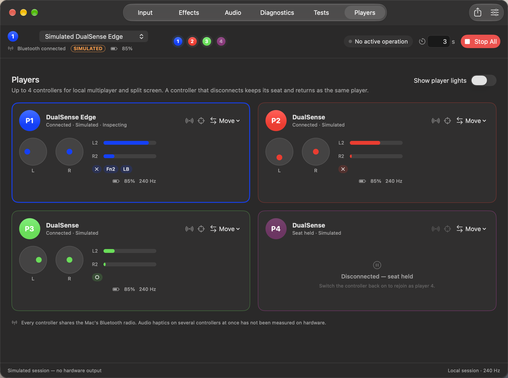
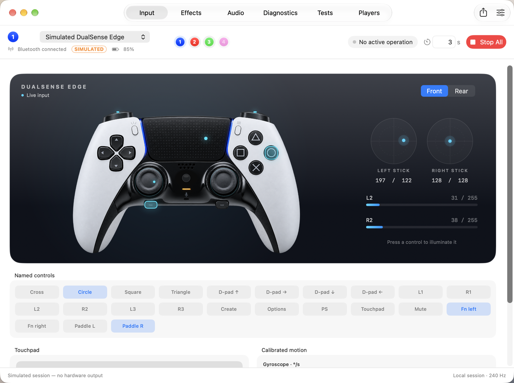

# Tactile

**Full-feature Bluetooth support for DualSense and DualSense Edge controllers on macOS.**

Tactile is a Swift package (with a C ABI) that gives macOS apps and game engines the
parts of the DualSense feature set that Apple's GameController framework does not
expose: HD audio-haptics over Bluetooth, every adaptive-trigger effect, lightbar,
player and mute LEDs, calibrated IMU, and the Edge's paddles and Fn buttons.

It works *alongside* GameController: GameController keeps doing discovery and
standard input; Tactile talks to the controller's HID protocol directly for the rest.





*Tactile Lab, the companion macOS app (`App/`), shown in its simulation mode: no
controller was connected for these captures.*

> Status: 0.1.0, pre-release. All software gates (0–4) are built and unit-tested, but
> **nothing has been verified on a controller yet** — see `docs/receipts/` and the
> status column in `PROTOCOL.md`.

## What it can and cannot do

- ✅ Any app or engine that links Tactile gets the full feature set.
- ❌ It cannot add features to games that do not link it. That would need a
  system-wide virtual controller (restricted Apple entitlement
  `com.apple.developer.hid.virtual.device`); out of scope.

## Requirements

- macOS 15 or later (CoreHID), Apple silicon (Intel builds but is untested)
- Swift 6 toolchain (Xcode 16+)
- **Input Monitoring** permission for the host app (see `docs/Permissions.md`)

## Modules

| Module | Purpose |
|---|---|
| `TactileCore` | Pure protocol logic: CRC, report parsers/builders, trigger effects, calibration. No I/O. |
| `TactileTransport` | CoreHID discovery, report I/O, reconnects, shared/exclusive modes, permission checks. |
| `TactileHaptics` | Float PCM → 3 kHz 8-bit stereo, real-time 10.67 ms report pump, audio-tap and parametric sources. |
| `TactileBridge` | Pairs HID devices with `GCController`s by Bluetooth MAC address. |
| `TactileAudio` | **Experimental.** Speaker/headphone audio (Opus, report 0x36) and microphone uplink research, via the system Opus codec. |
| `Tactile` | High-level `Controller` facade. |
| `CTactile` | C ABI (`include/tactile.h`) for engines and non-Swift hosts. |
| `tactilectl` | CLI demo and hardware test harness. |

## Quick start

For a native graphical tester, open **[Tactile Lab](App/README.md)** with
`./scripts/run-lab.sh` or `TactileLab.xcodeproj`. The app requires Apple silicon
and macOS 27, provides five testing tabs and local session exports, and includes
a visibly labeled simulation for use without hardware. Physical Bluetooth
acceptance remains deferred; see the [October audit](docs/receipts/audit-2026-10-18.md).

```swift
import Tactile

let manager = ControllerManager()          // shared mode by default
for await controller in manager.connectedControllers() {
    try await controller.setLightbar(LightbarColor(red: 255, green: 0, blue: 128))
    try await controller.setTrigger(.right, try .weapon(start: 3, end: 6, strength: 8))
    try await controller.play(.click())      // Bluetooth audio haptics

    for await event in await controller.inputEvents() {
        if event.state.buttons.contains(.paddleLeft) { /* DualSense Edge paddle */ }
    }
}
```

```bash
swift run tactilectl permission           # grant Input Monitoring to your terminal
swift run tactilectl info
swift run tactilectl trigger right weapon 3 6 8
swift run tactilectl haptic --effect click
```

## Multiple controllers (local multiplayer, split screen)

Every connected controller gets a player number, 1–4 by default (up to 8). A
controller that disconnects keeps its seat and comes back as the same player; when
every seat is taken, the lowest seat held for a disconnected controller is reused.
Optionally, each controller shows its number on the player LEDs and its player
colour (blue, red, green, pink) on the lightbar.

```swift
let manager = ControllerManager()
let players = PlayerAssigner()          // PlayerOptions: capacity, holdDisconnected, applyLights, colors
players.attach(to: manager)

if let p2 = players.controller(forPlayer: 2) {
    try await p2.setTrigger(.right, try .weapon(start: 3, end: 6, strength: 8))
}
players.assign(someController, to: 1)   // swaps with whoever was player 1
```

C hosts use `tactile_context_get_player`, `tactile_context_assign_player` and
`TACTILE_EVENT_PLAYER_CHANGED` (ABI 0.2). The Unity, Godot, Unreal and Python
bindings expose the same per-player API; Unity ships a split-screen sample. All
controllers share the Mac's Bluetooth radio, and running audio haptics on several
at once has not been measured on hardware.

## Documentation

- `PROTOCOL.md` — every protocol fact, its source, and verification status
- `TESTING.md` — manual hardware checklist
- `docs/Permissions.md`, `docs/Sandboxing.md`, `docs/Coexistence.md`, `docs/Distribution.md`
- `THIRD_PARTY_NOTICES.md` — attributions and licence decisions

## Licence

MIT. See `LICENSE` and `THIRD_PARTY_NOTICES.md`.

## Trademarks

Tactile is an independent project for DualSense controllers. It is **not affiliated
with, sponsored by, or endorsed by Sony Interactive Entertainment**. "DualSense" and
"PlayStation" are trademarks of Sony Interactive Entertainment Inc. and are used here
only to describe compatibility. No Sony logos are used.
